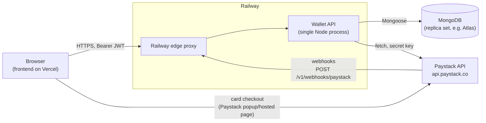
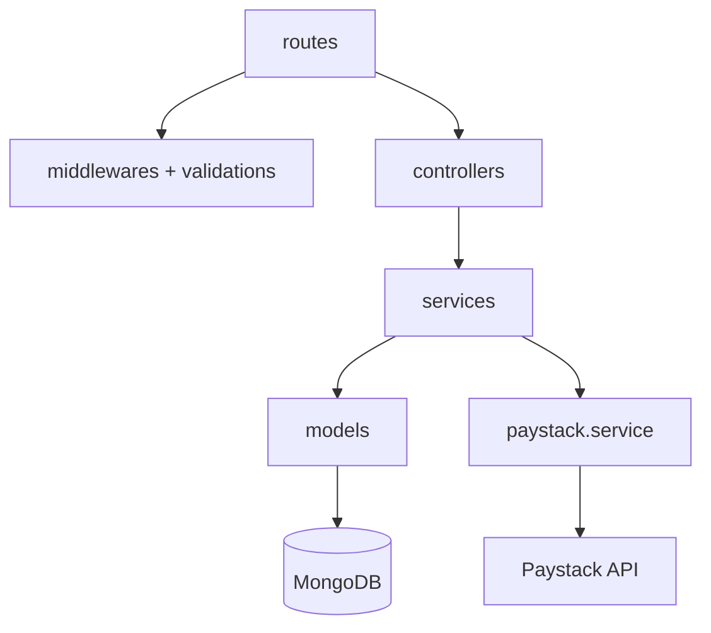
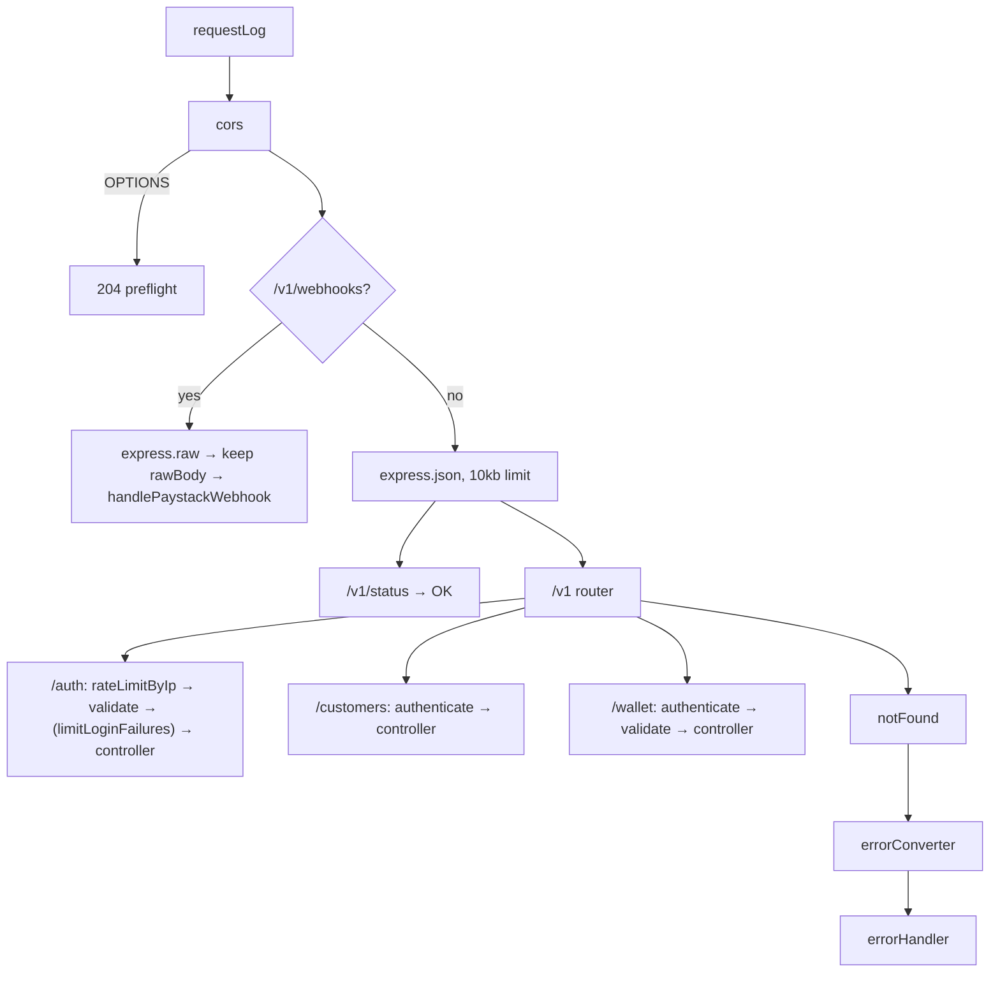
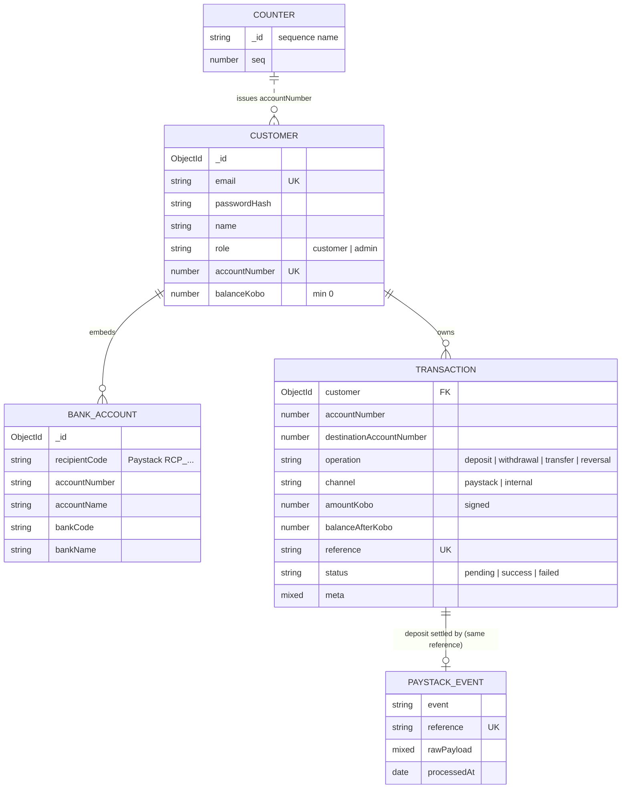
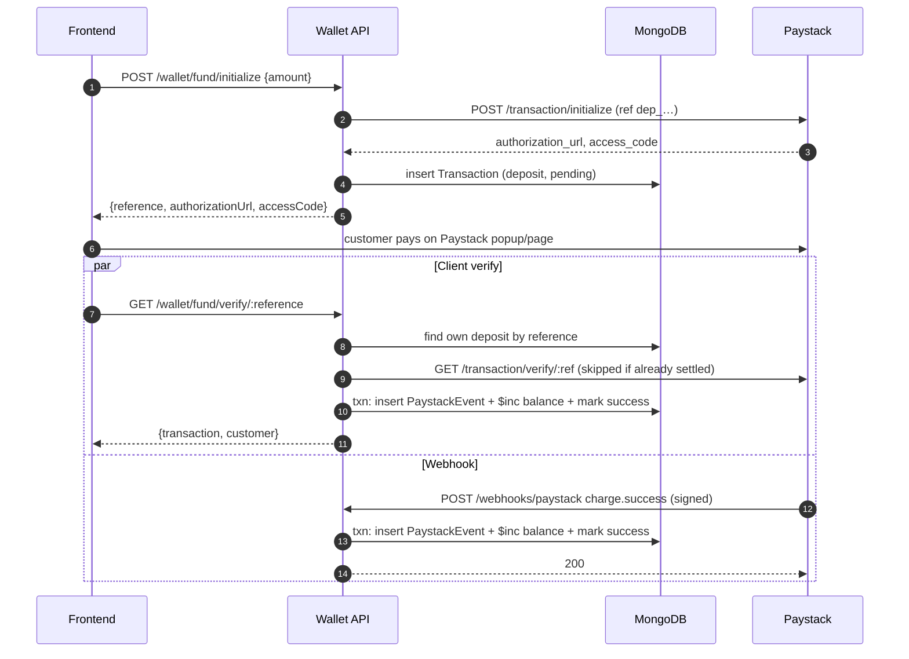
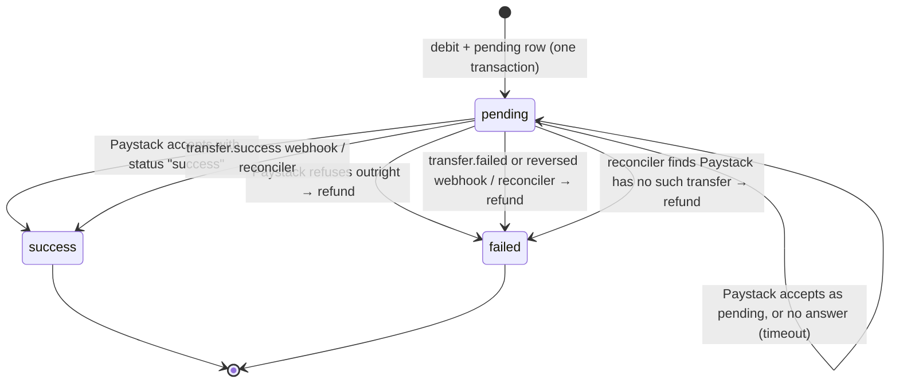

# Backend architecture

This document describes how the wallet API is built: the layers, the data
model, how each money flow works end to end, and the rules that keep balances
correct. It describes the code as of November 2026. The reasons behind
specific performance and reliability choices are recorded separately in
[`performance/`](performance/README.md); this document links to those records
rather than repeating them.

## Contents

1. [What the backend does](#1-what-the-backend-does)
2. [Technology and dependencies](#2-technology-and-dependencies)
3. [Runtime topology](#3-runtime-topology)
4. [Source layout and layers](#4-source-layout-and-layers)
5. [Process lifecycle](#5-process-lifecycle)
6. [Request pipeline](#6-request-pipeline)
7. [API surface](#7-api-surface)
8. [Data model](#8-data-model)
9. [Money handling](#9-money-handling)
10. [Authentication and authorization](#10-authentication-and-authorization)
11. [Paystack integration](#11-paystack-integration)
12. [Flows](#12-flows)
13. [Consistency and concurrency](#13-consistency-and-concurrency)
14. [Error handling](#14-error-handling)
15. [Observability](#15-observability)
16. [Configuration](#16-configuration)
17. [Deployment](#17-deployment)
18. [Known limits and future work](#18-known-limits-and-future-work)

---

## 1. What the backend does

The backend is a customer wallet. Each customer has one naira balance, held
by this service, and can:

- **Fund** the wallet by card through Paystack (Paystack Charge).
- **Transfer** money instantly to another customer's wallet. This never
  touches Paystack.
- **Withdraw** money to a Nigerian bank account through Paystack (Paystack
  Transfer).
- **See** their balance and transaction history.

The money customers hold in their wallets actually sits in the operator's
Paystack balance. The service's database is the ledger that says how much of
it belongs to whom.

## 2. Technology and dependencies

| Concern | Choice |
|---|---|
| Runtime | Node.js 20.12+ (`process.loadEnvFile`, native `fetch`, `AbortSignal.timeout`) |
| Language | TypeScript (strict), compiled with `tsc` to CommonJS in `dist/` |
| HTTP framework | Express 4 |
| Database | MongoDB through Mongoose 8 |
| Payment provider | Paystack REST API, called with native `fetch` |

The only runtime dependencies are `express` and `mongoose`. Everything that
projects usually pull in a package for is a small module here: JWT
(`utils/jwt.ts`), password hashing (`utils/password.ts`, `crypto.scrypt`),
validation (`validations/validate.ts`), CORS (`middlewares/cors.middleware.ts`),
rate limiting (`middlewares/rateLimit.middleware.ts`), request logging
(`middlewares/requestLog.middleware.ts`), caching (`utils/cachedValue.ts`) and
`.env` loading (`config/env.ts`). The [README](../README.md) lists what each
one replaces. Keep it that way: a new dependency needs a reason a few dozen
lines of code can't meet.

## 3. Runtime topology



- The **frontend** (in `../frontend`) calls the API from another origin, so
  the API answers CORS itself.
- The **API** is one stateless Node process. Its only in-memory state is
  caches and rate-limit counters (section 18 covers what changes with more
  than one instance).
- **MongoDB** should be a replica set so money movements run in transactions
  (section 13).
- **Paystack** is called by the API for charges, bank lookups and payouts,
  and calls back through signed webhooks. The customer enters card details on
  Paystack's own page or popup; card data never reaches this service.

## 4. Source layout and layers

```
src/
  index.ts           entry point: boot, HTTP server, reconciler, shutdown
  config/            env, MongoDB connection, transactions, Express app, threadpool
  routes/            URL → middleware chain → controller
  middlewares/       request log, CORS, auth, rate limits, 404, errors
  validations/       request schemas and the validator that runs them
  controllers/       HTTP glue: read req, call a service, write res
  services/          business logic and external calls
  models/            Mongoose schemas, indexes, response shapers
  utils/             ApiError, asyncHandler, jwt, password, money, cache, status codes
  types/express/     adds req.customer and req.rawBody to Express's Request type
```

Calls go one way, top to bottom:



What belongs where:

- **Routes** declare paths and their middleware chains. No logic.
- **Controllers** translate HTTP into service calls: read `req.body`,
  `req.params`, `req.query` and `req.customer`, parse and cap query
  parameters, choose the status code, send JSON. They hold no business rules.
- **Services** hold every business rule and every write. `wallet.service.ts`
  is the core; `paystack.service.ts` is the only module that talks to
  Paystack; `reconcile.service.ts` runs the background check;
  `auth.service.ts` handles register and login. Services throw `ApiError`
  and know nothing about Express.
- **Models** define schemas and indexes, plus `toPublic*` functions that
  shape documents for responses. Responses never send a raw document, so the
  password hash, Paystack recipient codes and internal metadata can't leak.

## 5. Process lifecycle

### Startup (`src/index.ts`)

1. `config/threadpool.ts` is imported first and sets `UV_THREADPOOL_SIZE` to
   16 unless the environment already sets it. scrypt hashing and the DNS
   lookups made by `fetch` share this pool, and it is sized before anything
   uses it ([record 12](performance/12-auth-rate-limits-and-threadpool.md)).
2. `config/env.ts` loads `backend/.env` if present (real environment
   variables win), checks required variables and exposes a typed `env`
   object. A missing required variable stops the process at boot.
3. `connectDB()` connects Mongoose, then asks the server `hello` to find out
   whether it is a replica set or a sharded cluster. It logs either
   `MongoDB supports transactions` or a warning that money movements will
   not be atomic.
4. `createApp()` builds the Express app (section 6) and the server starts
   listening on `PORT`.
5. Keep-alive is tuned: `keepAliveTimeout` defaults to 65 s, above the 60 s
   idle timeout of typical proxies, and `headersTimeout` is set one second
   higher ([record 10](performance/10-server-timeouts-and-shutdown.md)).
6. The withdrawal reconciler starts unless `RECONCILE_INTERVAL_MS=0`
   (section 12.5).

A MongoDB connection error at any time after boot exits the process, and the
platform restarts it.

### Shutdown

On `SIGTERM` or `SIGINT`:

1. Stop accepting connections, close idle keep-alive sockets, and add
   `Connection: close` to every in-flight response that hasn't sent headers,
   so those sockets close once they finish.
2. Wait for in-flight requests **and** any reconciler pass in progress, so
   the database never disconnects in the middle of settling money.
3. Disconnect Mongoose and exit 0.

A deadline (`SHUTDOWN_TIMEOUT_MS`, 10 s by default) cuts all remaining
connections and exits 1 if draining takes too long, for example when a
request is stuck waiting on Paystack. A second signal exits at once.

## 6. Request pipeline

`config/express.ts` mounts middleware in this order. The order matters.



1. **`requestLog`** is first so every request is timed, preflights and
   webhooks included.
2. **`cors`** answers preflights with 204 and sets CORS headers for allowed
   origins: those in `CORS_ORIGINS` (normalized, so a trailing slash or
   capital letters don't matter), plus any `localhost` / `127.0.0.1` /
   `[::1]` port outside production. It always sends `Vary: Origin`.
3. **The webhook router is mounted before `express.json()`.** Paystack signs
   the exact bytes it sends, so that route reads the body with
   `express.raw()` and keeps the untouched `Buffer` on `req.rawBody` for the
   HMAC check. If JSON parsing ran first, the signature could not be checked.
4. **Body parsers** run for everything else.
5. **`/v1/status`** is an unauthenticated health check.
6. **`/v1` routers.** Every `/wallet` route requires authentication (it is
   applied at router level). `/auth` routes are rate-limited per IP.
7. **`notFound`**, then **`errorConverter`** and **`errorHandler`**
   (section 14).

`trust proxy` is set to `TRUST_PROXY` hops so `req.ip` is the real client
behind Railway's edge, which per-IP rate limiting depends on.
`x-powered-by` is disabled.

## 7. API surface

All amounts in requests are **naira** (numbers, e.g. `500` or `500.5`).
Responses carry both `…Kobo` and `…Naira` fields.

| Method | Path | Auth | Body / query | Purpose |
|---|---|---|---|---|
| GET | `/v1/status` | – | – | Health check, returns `OK` |
| POST | `/v1/auth/register` | – | `email`, `password` (6–128), `name?` | Create customer and wallet, return JWT |
| POST | `/v1/auth/login` | – | `email`, `password` | Return JWT |
| GET | `/v1/customers/me` | JWT | – | Profile, balance and saved bank accounts |
| GET | `/v1/wallet/balance` | JWT | – | Same shape as `/customers/me` |
| GET | `/v1/wallet/transactions` | JWT | `page` (≤1000), `perPage` (≤200, default 30) | History, newest first |
| POST | `/v1/wallet/fund/initialize` | JWT | `amount` (100–1,000,000) | Start a Paystack charge |
| GET | `/v1/wallet/fund/verify/:reference` | JWT | – | Confirm a charge and credit once |
| POST | `/v1/wallet/transfer` | JWT | `destinationAccountNumber`, `amount` (10–1,000,000) | Wallet-to-wallet transfer |
| GET | `/v1/wallet/banks` | JWT | – | Paystack's bank list (cached) |
| POST | `/v1/wallet/bank-accounts` | JWT | `accountNumber` (10 digits), `bankCode` | Resolve and save a payout account |
| POST | `/v1/wallet/withdraw` | JWT | `amount` (100–1,000,000), `bankAccountId` | Pay out to a saved bank account |
| POST | `/v1/webhooks/paystack` | Paystack HMAC | Paystack event | Settle charges and transfers |

Response shapes come from `toPublicCustomer` (`models/customer.model.ts`)
and `toPublicTransaction` (`models/transaction.model.ts`). Money-moving
endpoints return `{ transaction, customer }` so the client can update the
balance without a second request. Errors are always
`{ code, message, errors? }` (section 14).

## 8. Data model



### Customer (`customers`)

One document per customer, holding the wallet itself.

- `balanceKobo` is the balance as an integer number of kobo, never negative.
  It is only changed by atomic `$inc` updates (section 13), never by reading,
  changing and saving the document.
- `accountNumber` is the internal wallet number other customers use to send
  transfers. It is taken from the `customerAccountNumber` sequence in the
  `counters` collection by a `pre('save')` hook when the customer is created.
- `bankAccounts` is an embedded array of saved payout destinations. Each
  holds the Paystack `recipientCode` that withdrawals are sent to. New
  entries are added with `$push`
  ([record 05](performance/05-bank-list-cache.md)).
- `role` exists for future admin routes; `authenticate(...roles)` can
  already restrict by it, but no route does today.

Indexes: unique `email`, unique `accountNumber`.

### Transaction (`transactions`)

The ledger: one row per balance change, per customer.

- `amountKobo` is **signed**: positive credits, negative debits. A transfer
  writes two rows, one for each side.
- `balanceAfterKobo` is the customer's balance right after the change, where
  known (it isn't set on a deposit until it succeeds).
- `reference` is unique and is the idempotency key for everything that
  involves Paystack. It is prefixed by kind: `dep_<uuid>` (deposit),
  `wdr_<uuid>` (withdrawal), `trf_<uuid>` (transfer, sender's row) and
  `trf_<uuid>_credit` (transfer, receiver's row). Deposit and withdrawal
  references are sent to Paystack, which echoes them back in verify replies
  and webhooks.
- `status` moves only from `pending` to `success` or `failed`. Transfers
  are written as `success` directly.
- `meta` holds withdrawal details: `bankAccountId`, `recipientCode` and,
  once Paystack accepts it, `transferCode`.
- The `reversal` operation is defined in the schema but not written by any
  code yet. Refunds of failed withdrawals credit the balance and mark the
  withdrawal row `failed`, rather than writing a separate reversal row.

Indexes:

| Index | Serves |
|---|---|
| `{ reference: 1 }` unique | Idempotency; lookups by reference |
| `{ customer: 1, createdAt: -1 }` | History query, sorted from the index ([record 01](performance/01-transaction-history-index.md)) |
| `{ accountNumber: 1 }` | Lookups by wallet number |
| `{ operation: 1, status: 1, _id: 1 }`, partial on pending withdrawals | The reconciler ([record 04](performance/04-withdrawal-reconciler.md)) |

### PaystackEvent (`paystackevents`)

One row per deposit that has been credited, keyed by a unique `reference`.
Inserting it is the "this charge has been credited" marker: the second
attempt to credit the same charge fails on the unique index and is treated
as already done (section 13). It also keeps the charge data that justified
the credit, for auditing.

### Counter (`counters`)

Named sequences incremented with `$inc` and `upsert`. Used only for wallet
account numbers.

## 9. Money handling

- **All stored amounts are integer kobo**, the unit Paystack uses. Floating
  point naira never reaches the database.
- **Conversion happens only at the HTTP edge.** `nairaToKobo` rounds the
  incoming naira amount (`Math.round(naira * 100)`), and responses add
  `…Naira = kobo / 100` beside each kobo field.
- **Limits** are enforced by validation: funding and withdrawals 100 to
  1,000,000 naira, transfers 10 to 1,000,000 naira.
- **The balance can't go negative.** Debits are conditional updates that
  match only if `balanceKobo >= amount`, and the schema also sets `min: 0`.
- **Paystack is believed only for the amount we asked for.** A deposit is
  credited only if the paid amount equals the pending row's `amountKobo` and
  the currency is NGN. A mismatch is left pending for someone to look into.

## 10. Authentication and authorization

- **Passwords** are hashed with `crypto.scrypt` (16-byte random salt, 64-byte
  key), stored as `salt:hash`, and compared in constant time.
- **Tokens** are HS256 JWTs signed with `JWT_SECRET`, carrying `sub` (the
  customer id), `iat` and `exp` (default 60 minutes). There are no refresh
  tokens; the client logs in again when a token expires. Signatures are
  compared in constant time.
- **`authenticate()`** reads `Authorization: Bearer <token>`, verifies it,
  loads the customer **lean and without the password hash**
  ([record 06](performance/06-lean-auth-customer.md)) and puts it on
  `req.customer`. A missing or deleted customer is a 401.
- **Ownership** is enforced in the services, not by role. Every query is
  scoped to `req.customer`: history by `customer`, withdrawals only to the
  customer's own saved bank accounts, and deposit verification only for the
  customer's own references. Someone else's reference gets the same 404 as
  an unknown one, so references can't be probed
  ([record 09](performance/09-verify-ownership.md)).
- **Rate limits** on `/v1/auth/*`: `AUTH_RATE_LIMIT_PER_MINUTE` requests per
  client IP per minute, and `LOGIN_FAILURES_PER_15_MIN` failed logins per
  email address per 15 minutes, whatever the IP. Only 401s count toward the
  second, and a successful login clears it. Both use fixed windows held in
  memory and return 429 with `Retry-After`
  ([record 12](performance/12-auth-rate-limits-and-threadpool.md)).
- **Webhooks** are authenticated by checking `x-paystack-signature`, an
  HMAC-SHA512 of the raw body keyed with the Paystack secret key, in
  constant time. A bad signature gets a bare 401.

## 11. Paystack integration

`services/paystack.service.ts` is the only module that calls Paystack. It
wraps seven endpoints:

| Method | Paystack endpoint | Used by |
|---|---|---|
| `initializeTransaction` | `POST /transaction/initialize` | Funding, step 1 |
| `verifyTransaction` | `GET /transaction/verify/:ref` | Funding verify (client path) |
| `listBanks` | `GET /bank?country=nigeria&currency=NGN` | Bank picker, bank name lookup |
| `resolveAccountNumber` | `GET /bank/resolve` | Saving a bank account |
| `createTransferRecipient` | `POST /transferrecipient` | Saving a bank account |
| `initiateTransfer` | `POST /transfer` | Withdrawal |
| `verifyTransfer` | `GET /transfer/verify/:ref` | Reconciler |

Every call shares one `paystackRequest` helper, which distinguishes two kinds
of failure. This distinction is central to how money is handled:

- **`ApiError`**: Paystack answered and said no (a non-2xx status or
  `status: false`). The outcome is known: the request did not happen.
- **`PaystackUnavailableError`** (a subclass of `ApiError`, 502 or 504): no
  usable answer came back. The call timed out after `PAYSTACK_TIMEOUT_MS`,
  the connection failed, or the reply wasn't JSON. The outcome is
  **unknown**: Paystack may have acted on the request. Code that moves money
  must not treat this as a refusal
  ([record 03](performance/03-paystack-timeouts.md)).

The bank list is cached in memory for 24 hours with `cachedValue`:
concurrent callers share one fetch, failures are never cached, and a stale
list is served if a refresh fails.

### Webhooks handled

| Event | Action |
|---|---|
| `charge.success` | `confirmFunding(reference, { signedCharge: data })` |
| `transfer.success` | `resolveWithdrawal(reference, 'success')` |
| `transfer.failed` | `resolveWithdrawal(reference, 'failed')`, which refunds |
| `transfer.reversed` | `resolveWithdrawal(reference, 'reversed')`, which refunds |
| anything else | Ignored, 200 |

The handler answers 200 only when the event was handled or when retrying
can't change the outcome (an unknown reference, a charge that didn't
succeed, or an amount mismatch: 404, 402 or 409). Any other error, such as
the database being down, becomes a 500, so Paystack retries later instead of
the event being lost ([record 07](performance/07-webhook-signed-payload.md)).

## 12. Flows

### 12.1 Register and login

Register checks that the email is free, hashes the password, creates the
customer (which takes the next account number) and returns
`{ customer, token }` with 201. Login loads the customer by email, checks
the password and returns the same shape. A wrong email and a wrong password
both get the same 401 message.

### 12.2 Funding (deposit)



Both paths end in `walletService.confirmFunding`, and whichever arrives
first credits the wallet. The other finds it already done:

1. Find the deposit row by reference (for a customer, only among their own).
   Unknown: 404.
2. Already `success`: return the stored result without calling Paystack.
   Already `failed`: return 402 without calling Paystack, unless this is the
   signed webhook reporting success
   ([record 08](performance/08-verify-short-circuit.md)).
3. Get the charge's status: from the signed webhook payload if there is one
   (it is already authenticated, so no extra round trip), otherwise from
   `verifyTransaction`.
4. Not successful: mark the row `failed` only if Paystack's status is final
   (`failed` or `reversed`). Abandoned or in-progress charges stay pending,
   because the customer can still go back and pay. Return 402.
5. Amount or currency doesn't match: 409, row left pending.
6. In one transaction: insert the `PaystackEvent` marker, credit the
   wallet, and mark the row `success` with `balanceAfterKobo`. If the marker
   insert hits the unique index (code 11000), someone else already credited
   it, so read back and return the current state.

### 12.3 Wallet-to-wallet transfer

Synchronous, with no Paystack involvement:

1. Refuse a transfer to the sender's own account (400) or to an account
   number that doesn't exist (404).
2. In one transaction: conditionally debit the sender (400 if the balance
   is short), credit the receiver, and insert two `success` rows (`trf_…`
   with a negative amount for the sender, `trf_…_credit` with a positive
   amount for the receiver), each with its own `balanceAfterKobo`.

### 12.4 Saving a bank account

1. Start looking up the bank's display name from the cached bank list. If
   that fails, fall back to the bank code rather than fail the save.
2. `resolveAccountNumber` confirms the account exists and returns the
   account holder's name.
3. `createTransferRecipient` registers it with Paystack and returns a
   `recipient_code`.
4. `$push` the account onto the customer and return the updated profile.

### 12.5 Withdrawal and reconciliation



`walletService.withdraw`:

1. The `bankAccountId` must be one of the customer's saved accounts (404
   otherwise).
2. In one transaction: conditionally debit the wallet and insert a
   `pending` withdrawal row (`wdr_…`). The money is taken **before** asking
   Paystack, so it can't be spent twice while the payout is in progress.
3. **After that transaction commits**, call `initiateTransfer`. A
   transaction is never held open across a Paystack call.
4. Then, depending on the answer:
   - **Accepted**: save `transferCode` on the row. If Paystack already
     reports `success`, mark the row `success`; otherwise it stays pending
     for the webhook.
   - **Refused** (`ApiError`): in one transaction, refund the wallet and
     mark the row `failed`. Return the error.
   - **No answer** (`PaystackUnavailableError`): leave it pending and return
     success with the pending row. Refunding here could pay the customer
     twice if Paystack did send the money.

`walletService.resolveWithdrawal(reference, outcome)` settles a pending
withdrawal. The webhook and the reconciler both call it, possibly at the
same moment. Inside one transaction it does a conditional
`pending → success|failed` update. Only the caller whose update matches goes
on, and only it refunds on failure. It returns whether this call did the
settling.

**The reconciler** (`services/reconcile.service.ts`) catches withdrawals
that no webhook will settle: those whose transfer request timed out before
reaching Paystack, or whose webhook was lost. Every
`RECONCILE_INTERVAL_MS` (5 min) it:

1. Pages through pending withdrawals older than `RECONCILE_MIN_AGE_MS`
   (15 min), oldest first, 10 at a time, using the partial index.
2. Calls `verifyTransfer` for each item in a batch in parallel
   (`Promise.allSettled`, so one failure doesn't stop the rest).
3. `success` → settle as success. `failed` or `reversed` → settle and
   refund. "Transfer not found" → Paystack never got the request, so settle
   as failed and refund. Any other status (`pending`, `otp`, `received`, …)
   → leave it for the next run.
4. Logs a summary of outcomes.

Runs never overlap, and shutdown waits for the current run
([record 04](performance/04-withdrawal-reconciler.md)).

## 13. Consistency and concurrency

Correct balances rest on four mechanisms.

**1. Atomic single-document updates.** Balances change only through
`findOneAndUpdate` with `$inc`. A debit matches only
`{ _id, balanceKobo: { $gte: amount } }`, so two withdrawals at once can't
both spend the same money: MongoDB applies them one after the other, and the
second matches nothing if the first leaves too little.

**2. Multi-document transactions** (`config/transactions.ts`). Anything
that changes more than one document runs in `withTransaction`
([record 11](performance/11-mongo-transactions.md)):

| Operation | Committed together |
|---|---|
| Confirm deposit | PaystackEvent marker, wallet credit, deposit row → success |
| Transfer | Sender debit, receiver credit, both ledger rows |
| Withdraw (start) | Wallet debit, pending withdrawal row |
| Withdraw (refused) | Wallet refund, row → failed |
| Resolve withdrawal | Row pending → final, refund if failed |

Rules for code inside `withTransaction`:

- Pass `session` to **every** database call inside it.
- **No side effects outside the database**, especially no Paystack calls.
  The driver retries the function from the start on transient errors such as
  write conflicts, and a slow external call would hold locks open.
- On a standalone `mongod`, support is detected as absent at startup and
  `withTransaction` simply runs the function with `session = undefined`.
  Everything still works, but a crash part way through can leave balances and
  the ledger out of step. Production must use a replica set.

**3. Unique references as idempotency keys.** The unique `reference` on
`paystackevents` means a deposit is credited at most once, however many
times the webhook is retried and however it races the client's verify call.
Because the marker commits in the same transaction as the credit, a crash
can't leave the marker written without the credit.

**4. Conditional state transitions.** Withdrawals move from `pending` to a
final state only through an update filtered on `status: 'pending'`, so the
webhook and the reconciler can't both settle (and both refund) the same one.

Underneath all four is the rule from [record 03](performance/03-paystack-timeouts.md):
**no answer is not a no.** When Paystack doesn't answer, nothing is refunded
or failed. It is left pending for a webhook or the reconciler, which only
act on what Paystack actually reports.

## 14. Error handling

- Services and middleware throw `ApiError(message, status, errors?)`.
- Every async controller and middleware is wrapped in `asyncHandler`, which
  passes rejected promises to `next()` (Express 4 doesn't do this itself).
- `errorConverter` turns anything that isn't an `ApiError` into one: a
  MongoDB duplicate-key error (11000) becomes 409, and anything else keeps
  its `status` or becomes 500.
- `errorHandler` responds with `{ code, message, errors? }`, plus `stack`
  outside production.
- Validation failures are 400 with `errors: [{ field, message }]`, one entry
  per failing field (the first failed check for that field).

Status codes used by the domain:

| Status | Meaning here |
|---|---|
| 400 | Validation error, insufficient balance, transfer to self |
| 401 | Missing, invalid or expired token; wrong credentials; bad webhook signature |
| 402 | The charge didn't succeed |
| 403 | Role not allowed |
| 404 | Unknown (or someone else's) reference, account or bank account |
| 409 | Duplicate email or record; paid amount doesn't match |
| 429 | Rate limited, with `Retry-After` |
| 502 / 504 | Paystack unreachable or too slow |

## 15. Observability

- **Request log**: one line per request when it finishes, for example
  `2026-11-21T21:50:00.000Z GET /v1/wallet/transactions 200 12.3ms`.
  Requests whose client hung up are logged with status `aborted`
  ([record 02](performance/02-request-timing-log.md)).
- **Startup log**: whether MongoDB supports transactions.
- **Money paths** log with `console.error` when a withdrawal is left
  pending after a Paystack timeout, when a `charge.success` webhook is
  acknowledged without crediting, and for each reconciler failure. Each
  reconciler run that found work logs a summary.
- In development, Mongoose logs every query.

Everything goes to stdout and stderr, which Railway collects. There are no
metrics or alerts yet; at minimum, alert on the money-path error lines
above.

## 16. Configuration

Everything comes from environment variables, read and checked once in
`config/env.ts`. [`.env.example`](../.env.example) documents each one.

| Variable | Default | Purpose |
|---|---|---|
| `MONGO_URI` | **required** | MongoDB connection string |
| `JWT_SECRET` | **required** | HMAC key for tokens; at least 32 characters, enforced in production |
| `PAYSTACK_SECRET_KEY` | **required** | Paystack API key and webhook HMAC key |
| `PORT` | `4000` | Listen port (must match the Railway domain's target port) |
| `NODE_ENV` | `production` | only `development`/`test` show stacks, log queries and allow loopback CORS; unset means production |
| `CORS_ORIGINS` | `http://localhost:5173` | Comma-separated allowed browser origins |
| `JWT_EXPIRES_IN_MINUTES` | `60` | Token lifetime |
| `PAYSTACK_PUBLIC_KEY` | `''` | Read into config; not used by the server |
| `PAYSTACK_CALLBACK_URL` | `''` | Redirect after hosted checkout |
| `PAYSTACK_TIMEOUT_MS` | `10000` | Deadline for each Paystack call |
| `RECONCILE_INTERVAL_MS` | `300000` | Reconciler period, `0` disables it |
| `RECONCILE_MIN_AGE_MS` | `900000` | Minimum age of a withdrawal before reconciling |
| `KEEP_ALIVE_TIMEOUT_MS` | `65000` | Idle keep-alive socket timeout |
| `SHUTDOWN_TIMEOUT_MS` | `10000` | Graceful shutdown deadline |
| `TRUST_PROXY` | `0` | Proxy hops to trust for `req.ip` (`1` on Railway) |
| `AUTH_RATE_LIMIT_PER_MINUTE` | `20` | Auth requests per IP per minute |
| `LOGIN_FAILURES_PER_15_MIN` | `10` | Failed logins per email per 15 minutes |
| `UV_THREADPOOL_SIZE` | `16` | libuv threadpool size (set in code unless already set) |

## 17. Deployment

- **Build and run**: `npm run build` (tsc to `dist/`), then
  `npm start` (`node dist/index.js`). In development, run
  `npm run dev:build` and `npm run dev` side by side.
- **Hosting**: the API runs on Railway behind its edge proxy; the frontend
  is on Vercel.
- **Checklist** (also in [performance/README.md](performance/README.md#deployment-checks)):
  1. `TRUST_PROXY=1`, or every client shares one rate limit keyed on the
     proxy's IP.
  2. MongoDB is a replica set: look for `MongoDB supports transactions` in
     the startup log.
  3. `PORT` matches the target port of the Railway domain. A mismatch shows
     up as 502s, which the browser may report as CORS errors because the
     proxy's error page has no CORS headers.
  4. Railway's shutdown grace period is longer than `SHUTDOWN_TIMEOUT_MS`.
  5. `CORS_ORIGINS` includes the deployed frontend's origin.
  6. Paystack's webhook URL points at `https://<api-host>/v1/webhooks/paystack`.
  7. The redundant `customer_1` index on `transactions` has been dropped.
- **Local webhooks**: tunnel the local port (for example `ngrok http 4000`)
  and point Paystack's test webhook URL at the tunnel.

## 18. Known limits and future work

- **One instance.** Rate-limit counters and the bank-list cache live in
  process memory, so with several instances each enforces its own limits,
  and each instance runs its own reconciler. The reconciler is safe to run
  more than once (settling is conditional), but it multiplies Paystack
  calls. Scaling out would need shared rate-limit storage (or limits at the
  edge) and a single reconciler.
- **Offset pagination.** History uses `skip`, capped at page 1000. Keyset
  pagination on `(createdAt, _id)` would make deep pages cheap.
- **Dashboard totals are computed in the browser** from the latest 200
  transactions. An aggregation endpoint would send a few numbers instead.
- **Stuck pending deposits are never cleaned up.** A deposit that is
  initialized and never paid stays `pending`. It is harmless to the balance
  but clutters history.
- **Synchronous transfer success is saved unconditionally.** When
  `initiateTransfer` itself returns `success`, the row is updated with a
  plain `save()` rather than the conditional `pending → success` update.
  If a `transfer.failed` webhook settled and refunded the row in the short
  gap before that save, the save would overwrite `failed` with `success`.
  This is very unlikely, but routing it through `resolveWithdrawal` would
  close the gap.
- **No refresh tokens, logout or token revocation.** Tokens are valid until
  they expire.
- **No admin surface** for searching transactions, settling mismatched
  deposits or reviewing stuck withdrawals.
- **The `README.md` "things to harden" section is out of date**: it predates
  transactions (record 11) and rate limiting (record 12).
